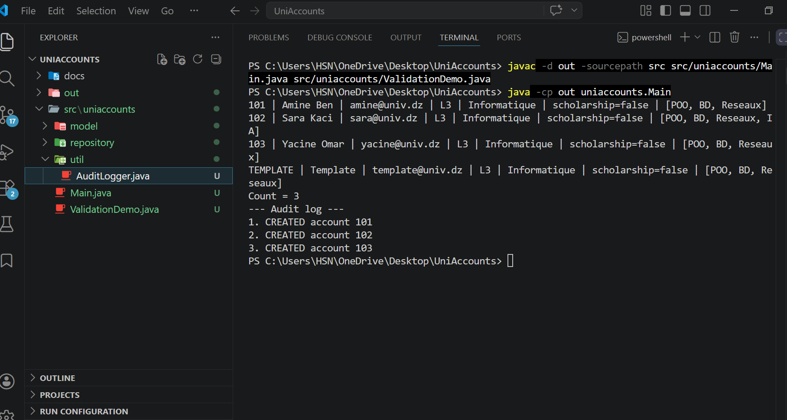

# UniAccounts - Work 1 (Creational patterns)

Core of a student account management system, built with three creational patterns.

| Pattern   | Class                              | Role |
|-----------|------------------------------------|------|
| Builder   | `StudentAccount.Builder`           | builds an account with 3 mandatory and 5 optional fields, and validates it |
| Singleton |three creational patt# UniAccounts -| one repository and one audit log in the whole program |
| Prototype | management system, built wit       | creates new accounts by cloning a template (deep copy of the courses) |

## Structure
t with three creational patterns.

| Pattern   | Class                              | Role |
|-----------|------------------------------------|------|
| Builder   | `StudentAccount.Builder`           | builds an account with 3 mandatory and 5 optional fields, and validates it |
| Singleton | `AccountRepository`, `AuditLo
## Run (JDK 17 or newer)

From the project root:
 of a student account management system, built with three creational patterns.

| Pattern   | Class                              | Role |
|-----------|-------------------
## Class diagram

## Screenshots

