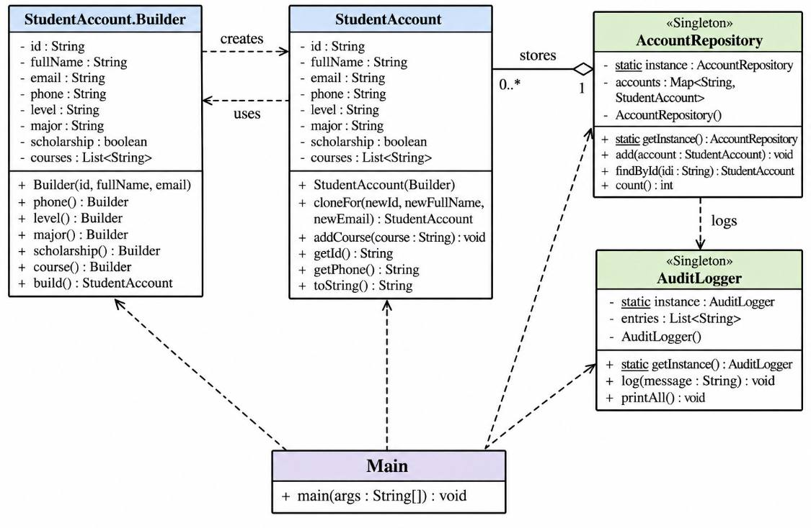
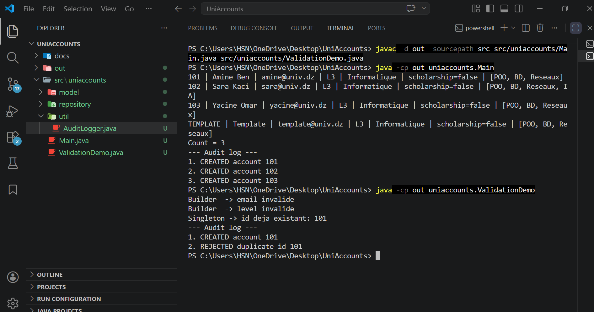
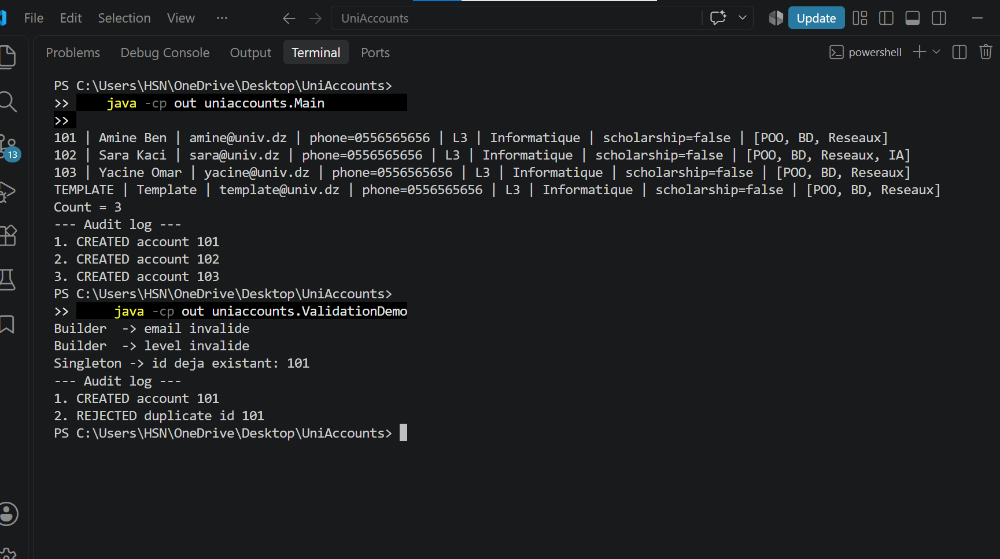

# UniAccounts - Work 1 (Creational patterns)

Core of a student account management system, built with three creational patterns: Builder, Singleton and Prototype.

## Structure

    src/uniaccounts/
      Main.java
      ValidationDemo.java
      model/StudentAccount.java
      repository/AccountRepository.java
      util/AuditLogger.java
    docs/

## How to run (JDK 17 or newer)

Open a terminal in the project root (the folder that contains src), then run these 3 commands:

1. Compile:

    javac -d out -sourcepath src src/uniaccounts/Main.java src/uniaccounts/ValidationDemo.java

2. Run the main demo:

    java -cp out uniaccounts.Main

3. Run the validation demo (shows rejected email, level and duplicate id):

    java -cp out uniaccounts.ValidationDemo

## Class diagram

## Screenshots

